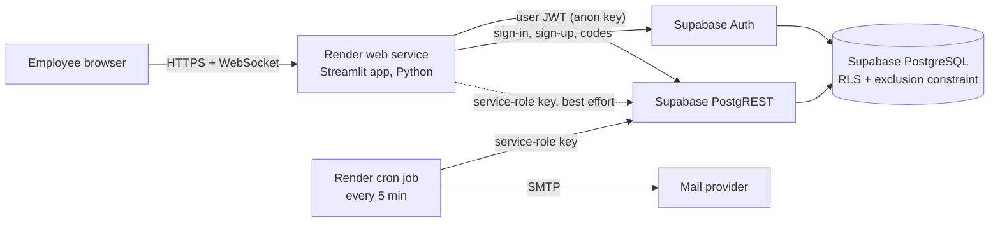
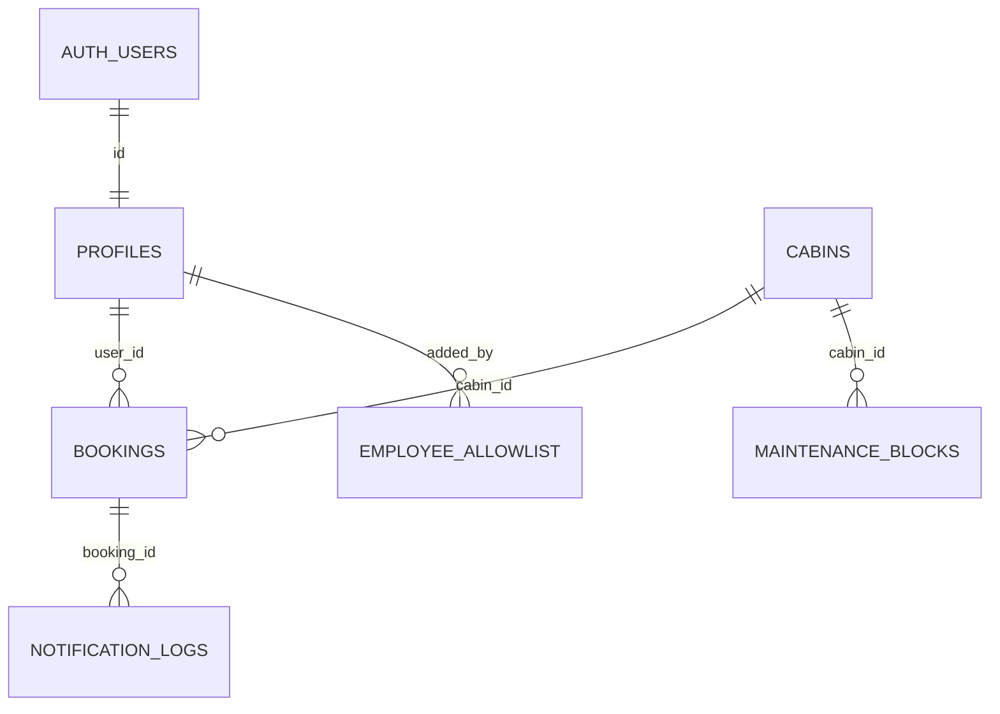

# Stage 1 — Architecture, security model and schema

**Wealthy Office Cabin Booking** lets verified `@wealthy.in` employees book one of ten meeting cabins for up to two hours, with conflict prevention enforced by PostgreSQL itself.

## 1. Decisions and assumptions

| Question from the brief | Decision used (all configurable) |
|---|---|
| Company e-mail domain | `wealthy.in` — `ALLOWED_EMAIL_DOMAIN` env var **and** `office_settings.allowed_email_domains` in the DB. A user must satisfy both. |
| Google Workspace or Microsoft 365? | Not stated. Implemented: Supabase e-mail + password with verified e-mail (6-digit code). SSO is an optional upgrade (section 7). |
| Office time zone | `Asia/Kolkata` (no DST). DST zones are supported and tested. |
| Operating hours | Placeholder **09:00–19:00, Mon–Fri**, editable in Admin › Settings. |
| Do bookings need admin approval? | No — bookings confirm instantly. **Employee access** does need approval by default (see 3.2). |
| Rescheduling | Not supported as a separate action: cancel and re-book (keeps the audit trail simple). |
| Cabin count | Exactly 10 seeded (`C01`–`C10`). Admins edit names, capacity, equipment, location, active flag; they cannot add or delete cabins from the UI. |

## 2. Architecture



| Layer | Technology | Why it fits |
|---|---|---|
| UI + server | **Streamlit 1.65** (Python) | Brief's preferred stack. Renders entirely on the server, so tokens and keys never reach the browser; built-in XSRF protection; dialogs, fragments and navigation give a proper multi-page app. |
| Database | **Supabase PostgreSQL 15+** | Real transactions, `EXCLUDE USING gist` for overlap prevention, Row Level Security, point-in-time backups. |
| Auth | **Supabase Auth** | bcrypt-hashed passwords, e-mail ownership proof, rate limiting, JWTs that PostgreSQL policies can read via `auth.uid()`. |
| API | **PostgREST** (part of Supabase) | Every request runs as the `authenticated` role with the user's JWT, so RLS applies to every read and write. |
| Hosting | **Render** web service + cron job | Simple Git-based deploys, WebSocket support (Streamlit needs it), managed TLS and custom domains. |
| E-mail | **Any SMTP provider** via a transactional outbox | Booking and e-mail are decoupled: a mail outage can neither lose nor duplicate a booking. |

**Is Streamlit the right production frontend?** It is suitable for an internal tool of this size (tens to a few hundred users, one office). Its trade-offs, accepted here: sessions live in server memory (run **one** Render instance; a browser refresh requires signing in again), and pixel-level UI control is limited. If the office later needs many instances, offline-capable mobile use, or deep calendar integrations, the recommended path is a Next.js frontend calling the **same** database functions — the security boundary is in PostgreSQL, so nothing in the schema would change.

### Request flow for a booking

1. The employee picks cabin, date, start and duration in the booking dialog. The end time is computed, never typed.
2. The app validates the same rules locally for instant feedback (`core/booking_service.py`).
3. The app calls `rpc('book_cabin', …)` **with the user's JWT**. There is no user-id parameter: the owner is always `auth.uid()`.
4. Inside one transaction `cabins.book_cabin()` re-checks: active verified employee, domain, duration (min ≤ d ≤ 120), on whole minutes, not in the past, within the booking horizon, working day, office hours **in the office time zone**, cabin active, capacity, and maintenance blocks. It then takes a per-cabin advisory lock and inserts.
5. The `bookings_no_overlap` exclusion constraint makes overlapping confirmed bookings for one cabin **impossible**, including under concurrent requests. A losing request gets `CABIN_ALREADY_BOOKED`.
6. A `notification_logs` row is written in the same transaction. Only after the commit does the UI show "Booked … Reference WCB-xxxxxx".
7. E-mail is sent after commit (immediately if the web service has SMTP configured, and by the cron job otherwise / on retry).

## 3. Security model

### 3.1 Identity — who are you?
* Supabase Auth proves identity: password (hashed by Supabase, never seen or stored by this app) plus **proof of mailbox ownership** via the 6-digit verification code or link.
* **Shared Supabase project.** The app is designed to live in a project used by other apps (e.g. the CRM): everything is created in the `cabins` and `cabins_private` schemas, nothing in `public` is created or changed, and sign-ups for other apps are never blocked. Instead, a trigger on `auth.users` creates a cabin profile **only** for addresses whose domain is **exactly** an allowed domain; any other login (`x@gmail.com`, `x@evilwealthy.in`, `x@wealthy.in.example.com`, `x@sub.wealthy.in`…) gets no profile, so RLS gives it no data and every booking function refuses it — even if someone calls the Supabase Auth API directly.
* The app refuses non-company addresses before calling Supabase Auth at all (sign-up, sign-in, reset).
* The app checks the domain again before every auth call and on every page load against the server-side `ALLOWED_EMAIL_DOMAIN`.

### 3.2 Authorisation — what may you do?
A verified `@wealthy.in` address is **not** sufficient on its own. `cabins_private.is_active_employee()` is true only when **all** hold:

| Check | Source |
|---|---|
| `profiles.status = 'active'` | set by policy below or by an admin |
| e-mail confirmed, not banned, not deleted | `auth.users` |
| auth e-mail equals profile e-mail and is on an allowed domain | both tables |

How a profile becomes active depends on `office_settings.access_policy`:

* **`approval` (default)** — active only if the address is on `employee_allowlist` (admins pre-approve addresses) or an admin approves it. Verified-but-unapproved users see an "awaiting approval" screen and RLS returns nothing to them.
* **`domain`** — any verified address on the domain is activated automatically.

Disabled profiles are never reactivated automatically, and their booking history is kept.

**Roles.** `employee` or `admin`. Nobody can register as an admin. The very first admin is created by a project owner running `cabins_private.bootstrap_first_admin('…@wealthy.in')` in the Supabase SQL editor (not callable via the API, refuses if an admin exists or the e-mail is unverified). Later admins are promoted by an existing admin; admins cannot change their own role or access. Role/status columns have no API update grant, and a trigger blocks any change by the `authenticated` role as defence in depth.

### 3.3 How RLS interacts with Supabase Auth

```
browser ⇄ Streamlit server ──(Authorization: Bearer <user JWT>, apikey: anon)──▶ PostgREST
PostgREST verifies the JWT signature → SET ROLE authenticated → request.jwt.claims = {sub: <user id>, …}
auth.uid() reads sub → every policy below evaluates per row
```

| Table | Employee (active) | Admin | Writes |
|---|---|---|---|
| `bookings` | own rows only | all | only via `book_cabin`, `cancel_booking`, admin functions — no INSERT/UPDATE/DELETE grant |
| others' bookings | busy intervals only, via `get_availability()` (no title, notes, owner id; names only if admins enable it) | full | — |
| `cabins`, `maintenance_blocks`, `office_settings` | read | read + update (column-limited) | maintenance via admin functions |
| `profiles` | own row; may edit name/department | all | role/status via admin functions |
| `audit_logs`, `notification_logs`, `employee_allowlist` | none | read (allowlist: write) | audit is append-only (trigger) |
| `anon` (no JWT) | nothing except `get_public_branding()` | | |

`SECURITY DEFINER` functions run as the table owner but **always** start with `cabins_private.require_employee()` / `require_admin()`, use `search_path = ''`, and derive the caller from `auth.uid()`. The service-role key (bypasses RLS) is used only by the e-mail worker and is never sent to a browser.

### 3.4 Other controls
* **XSS**: Streamlit escapes text by default; every value interpolated into custom HTML passes through `core.security.esc()`. Logo URLs must be `https://`.
* **CSRF**: Streamlit's XSRF protection is enabled (`.streamlit/config.toml`); state changes happen over its authenticated WebSocket, not form posts.
* **SQL injection**: no SQL is built from user input; all access is through PostgREST parameters and typed function arguments.
* **Rate limiting**: Supabase Auth's server-side limits plus an in-process limiter (5 sign-ins / 15 min per e-mail, 3 sign-ups and resets / hour, 10 code attempts / 15 min).
* **Sessions**: JWT and refresh token live only in server memory for that browser session; idle timeout (default 60 min); sign-out revokes the session.
* **Errors**: users see friendly messages mapped from stable error codes; SQL text, stack traces (`showErrorDetails = "none"`) and credentials are never shown. Raw errors are logged server-side.
* **CSV export**: cells starting with `= + - @` are neutralised against spreadsheet formula injection; private meeting notes are excluded unless the admin opts in.
* **Privacy**: meeting notes are visible only to the owner and admins and are redacted from the audit log.

## 4. Database schema



| Table | Key columns and constraints |
|---|---|
| `office_settings` (1 row) | time zone (validated), open/close time, working days (ISO), min/max minutes (max ≤ **120** by CHECK), slot size, horizon, cancel cut-off, reminder minutes, access policy, allowed domains, branding |
| `profiles` | `id` = `auth.users.id`; e-mail (lower-case, unique); role `employee/admin`; status `pending/active/disabled`; approval/disable metadata |
| `employee_allowlist` | pre-approved e-mails (domain validated) |
| `cabins` | UUID; code `C01`…`C10` unique; name; location; capacity 1–100; `equipment text[]`; active flag; order |
| `bookings` | UUID + human reference `WCB-100001`; cabin; owner; `start_at`/`end_at` **timestamptz**; title (3–120); attendees; notes (≤1000); status `confirmed/cancelled` + who/when/why; `CHECK end > start`, `CHECK end − start ≤ 120 min`, **`EXCLUDE USING gist (cabin_id WITH =, tstzrange(start_at, end_at, '[)') WITH &&) WHERE status = 'confirmed'`**; indexes on (user, start), (start), (cabin, start), (status, start) |
| `maintenance_blocks` | cabin; period; reason; `active/removed`; GiST index on (cabin, range) |
| `audit_logs` | append-only; actor, action (`booking.created`, `booking.cancelled`, `profile.role_changed`, `profile.status_changed`, `office_settings.update`, …), entity, JSON diff with notes redacted |
| `notification_logs` | outbox: booking, kind, recipient, status `pending/sending/sent/failed/skipped`, attempts, back-off, `UNIQUE (booking_id, kind)` |

**Time.** Instants are stored as `timestamptz` (UTC internally) and converted to the office zone for validation and display. Intervals are half-open `[start, end)`, so 10:00–11:00 and 11:00–12:00 do not conflict. Wall-clock times that do not exist on a DST change day are rejected; 23/25-hour days are handled.

**Migrations** (`database/migrations/`, applied in order by `scripts/apply_migrations.py`, which records checksums in `cabins_private.schema_migrations`):

| File | Contents |
|---|---|
| `0001_foundation.sql` | extensions, `private` schema, settings, e-mail helpers |
| `0002_identity_and_audit.sql` | audit log, profiles, allowlist, `auth.users` triggers, `is_active_employee()` / `is_admin()` |
| `0003_cabins_and_bookings.sql` | cabins, maintenance, bookings + exclusion constraint, notification outbox |
| `0004_booking_and_admin_functions.sql` | `book_cabin`, `cancel_booking`, `get_availability`, admin functions, worker functions, `bootstrap_first_admin` |
| `0005_rls_and_grants.sql` | RLS policies and least-privilege grants |
| `0006_seed_cabins.sql` | the ten cabins (idempotent) |

## 5. Booking rules (all enforced in the database)

| Rule | Error code |
|---|---|
| Cabin, start, end, purpose required | `MISSING_FIELDS`, `INVALID_TITLE` |
| Duration ≥ min (default 15) and ≤ max (≤ 120 hard) | `DURATION_TOO_SHORT`, `DURATION_TOO_LONG` |
| Within office hours on a working day (office zone) | `OUTSIDE_OFFICE_HOURS`, `NON_WORKING_DAY` |
| Not in the past / not beyond horizon | `BOOKING_IN_PAST`, `BOOKING_TOO_FAR_AHEAD` |
| Cabin active, attendees ≤ capacity | `CABIN_INACTIVE`, `CAPACITY_EXCEEDED` |
| No maintenance overlap | `CABIN_UNDER_MAINTENANCE` |
| No overlap with another confirmed booking | `CABIN_ALREADY_BOOKED` (exclusion constraint) |
| Employee cancels own booking before `start − cut-off` | `CANCELLATION_WINDOW_CLOSED`, `BOOKING_NOT_FOUND` for others' bookings |
| Admin may cancel any booking that has not ended | — |

Different cabins can be booked at the same time by the same person.

## 6. Notifications

Outbox pattern: the booking transaction inserts the notification row; `claim_notifications()` hands rows to one worker at a time (`FOR UPDATE SKIP LOCKED`, 10-minute lease); `complete_notification()` records `sent` / `failed` with exponential back-off (max 5 attempts). Admins can retry failures. Kinds: confirmation, self-cancellation, admin cancellation, maintenance cancellation, reminder (default 15 minutes before). Each e-mail includes cabin, date, start, end, meeting title and booking reference.

## 7. Optional: single sign-on with Google Workspace or Microsoft 365

Domain checks prove nothing by themselves; SSO lets the company identity provider vouch for the employee (and lets IT disable access centrally).

* **Google Workspace** — enable the Google provider in Supabase Auth with a Google Cloud OAuth client of type *Internal* (only Workspace accounts of `wealthy.in` can consent). Optionally pass `hd=wealthy.in`. The profile trigger and `is_active_employee()` still apply.
* **Microsoft 365 / Entra ID** — enable the Azure provider in Supabase with a single-tenant app registration (`https://login.microsoftonline.com/<tenant-id>`), so only the Wealthy tenant can sign in.
* **SAML SSO** (Supabase Pro and above) works with both and can enforce SSO-only sign-in for the domain.

This is **not implemented in the current code**: OAuth needs a redirect handler that exchanges the PKCE code for a Supabase session (a small addition to `views/login.py` using `st.query_params` and `client.auth.exchange_code_for_session`). No schema or policy changes are required.
